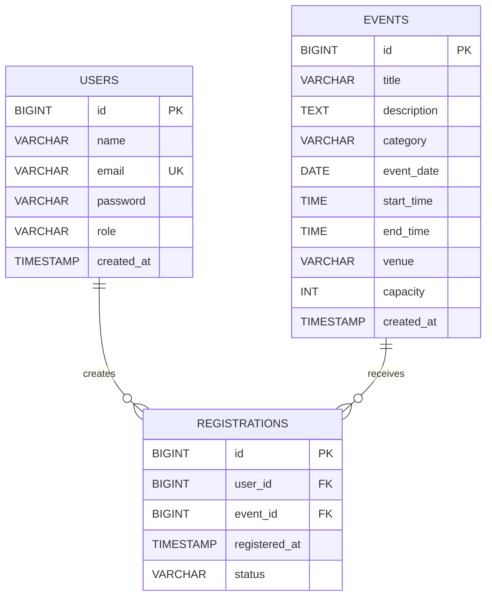

# CampusConnect ER Diagram

`REGISTRATIONS` is the joining entity for the logical many-to-many
relationship between users and events. The database enforces unique
`(user_id, event_id)`, foreign keys and non-null required values.
